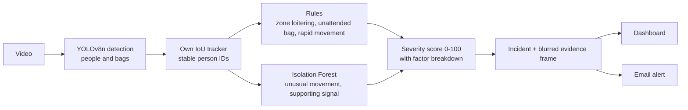

<div align="center">

# 🛡️ VisionGuard AI

### From noisy alarms to *explained* incidents

Explainable video surveillance that runs fully on a **CPU-only laptop**.
No cloud. No GPU. No paid API.


</div>

---

## The problem

A simple CCTV rule raises an alert on **every frame** in which someone is inside a restricted area.
One person standing there for ten seconds becomes hundreds of alerts, and the operator stops trusting them.

**VisionGuard watches the footage, ignores the noise, and shows only what needs a human, with the reason and the evidence.**

## At a glance

| | |
|---|---|
| **Naive per-frame alerts** | 168 |
| **VisionGuard incidents** | **1** |
| **Alert reduction** | **99.4 %** |
| **People / objects tracked** | 19 / 4 |
| **Speed (CPU-only laptop)** | about 218 ms per frame (4.1 fps) |

<sub>Measured on one 19 s test clip. The reduction is against a deliberately simple baseline and shows **less noise**, not detection accuracy.</sub>

## How it works



1. **Detect:** YOLOv8n (ONNX Runtime, CPU) finds people and bags in sampled frames.
2. **Track:** an IoU tracker written from scratch links boxes across frames, so one person keeps one ID. It stitches broken tracks and drops short noise tracks.
3. **Explain:** plain, deterministic rules decide what is an incident. Every incident gets a 0 to 100 severity score, and the factor bars on screen **are** the calculation.

## Features

| Area | What you get |
|---|---|
| **Detection** | People, backpacks, handbags and suitcases with per-class confidence |
| **Tracking** | Custom IoU tracker, track stitching, noise filtering |
| **Rules** | Restricted-zone loitering, unattended object, rapid movement. All limits are editable |
| **Scoring** | Severity 0 to 100 from named factors, with a visible breakdown |
| **Anomaly signal** | Isolation Forest on track features. It only switches on when there are enough tracks |
| **Evidence** | One frame per incident, **people blurred by default** |
| **Alerts** | Automatic email, once per incident per analysis. Optional short notice for every zone entry |
| **Dashboard** | Live monitoring, zone drawing, incident queue, timeline, heatmap, analytics, report export |
| **Baseline** | Built-in comparison against a naive per-frame alert counter |

## Run it locally

```bash
# 1. create and activate a virtual environment (Windows PowerShell)
python -m venv .venv
.venv\Scripts\Activate.ps1

# 2. install
pip install -r requirements.txt

# 3. start
python app.py
```

Then open **http://127.0.0.1:8000**, pick a video, draw a restricted zone and press **Analyze**.

**Model:** `models/yolov8n.onnx` must exist. If you do not have it, see `export_model_colab.py` (one-time export in Google Colab). An optional `models/yolov8n-640.onnx` is used automatically when present (more accurate, slower).

**Videos:** put your clips in `data/videos/` or use **Upload video** in the dashboard.

**Email alerts (optional):** Alerts page, switch on Email, add a Gmail address and a Gmail *app password*, then Save. The password stays in `data/notify.json` on your machine and is never sent to the browser. **Never commit that file.**

## Deploy a public demo (optional)

A `Dockerfile` is included for **Hugging Face Spaces (Docker SDK)**. In the public demo (`VG_PUBLIC=1`) email alerts and their settings are switched off, because the page has no login. Keep demo videos short (10 to 20 s), since analysis runs on a shared CPU.


## Project structure

```
app.py                 web server and API
config.py              thresholds and settings
core/
  detector.py          YOLOv8n ONNX decoding
  tracker.py           IoU tracker
  pipeline.py          video to tracks
  analysis.py          rules, scoring, evaluation
  notify.py            email alerts
  webcopy.py           browser-playable video copies
web/index.html         dashboard (plain HTML, CSS, JavaScript)
```

## Honest limitations

- It flags **patterns** (too long in a zone, an object left alone, fast movement). It does not understand intent, and a human makes the final decision.
- Small or blurred bags are hard for a tiny model at 320 px input, so object detection can miss them.
- Anomaly scoring needs several tracks to mean anything. On very short clips it stays off.
- Tracker IDs can change when a person is hidden for a while. Track stitching reduces this but does not remove it.
- Thresholds are tuned by hand for the scene and can be edited in the dashboard.

## Tech stack

Python · OpenCV · NumPy · ONNX Runtime · scikit-learn · imageio-ffmpeg · psutil · plain HTML, CSS and JavaScript

## Credits and license note

Detection uses **YOLOv8 (Ultralytics, AGPL-3.0)**. The tracker, rules, scoring, alerts and dashboard are written from scratch for this project. Check the YOLOv8 license before any commercial use.

<div align="center">

Built solo in a college hackathon by **Komal Sahu**

</div>
